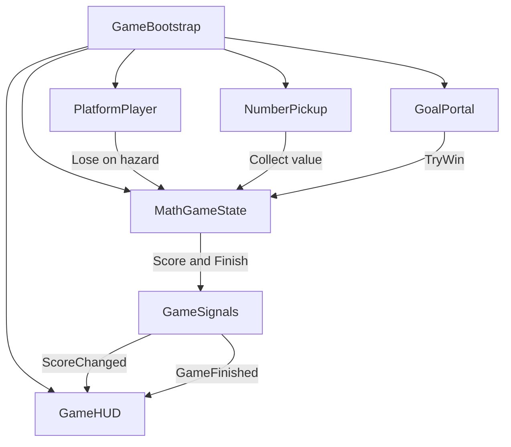

# Math Kingdom

## Assignment 4 — Core Gameplay, Physics and Architecture

### Game Overview

Math Kingdom is a 2D mathematics-themed platform game developed in Unity 6 using C#.

The player navigates platforms, collects numbered objects, and attempts to reach the green portal with the correct total. The game combines platform movement, jumping, collecting objects, and solving a mathematical objective.

### How to Play

The player starts on the left side of the level and must collect the numbers 2, 3, and 5.

The objective is to reach a total of **10** and enter the green portal before the 90-second timer expires.

**Controls**

- A / D — Move left and right
- Left / Right arrows — Move
- Space / Up arrow — Jump
- R — Restart

**Win condition:** Reach the portal with a total of exactly 10.

**Lose conditions:** Reach the portal with an incorrect total, run out of time, or fall into the hazard area.

### Running the Project

1. Download or clone the GitHub repository.
2. Open Unity Hub.
3. Add the project from disk.
4. Open it using Unity 6.
5. Open the game's main scene.
6. Press Play.

### Project Structure

```text
Assets/
├── Scripts/
│   ├── Player/
│   │   └── PlatformPlayer.cs
│   ├── Collectibles/
│   │   └── NumberPickup.cs
│   ├── Game/
│   │   ├── GameBootstrap.cs
│   │   ├── GameSignals.cs
│   │   ├── GoalPortal.cs
│   │   └── MathGameState.cs
│   └── UI/
│       └── GameHUD.cs
Packages/
ProjectSettings/
```

### Class Relationships and Events



### Class Responsibilities

| Class | Responsibility |
|---|---|
| GameBootstrap | Creates the level and game objects |
| PlatformPlayer | Handles movement, jumping and physical collisions |
| NumberPickup | Detects and processes number collection |
| MathGameState | Tracks the score, timer and game result |
| GoalPortal | Detects when the player enters the goal |
| GameSignals | Publishes gameplay events |
| GameHUD | Displays instructions, score and game results |

### Physics Implementation

Math Kingdom demonstrates three of the required Unity physics features:

**1. Rigidbody2D**

The player uses `Rigidbody2D` for gravity and physical movement.

**2. AddForce**

`PlatformPlayer` uses `AddForce` with `ForceMode2D.Impulse` to implement jumping.

**3. Collision2D**

`OnCollisionEnter2D` and related collision callbacks detect the ground and hazards.

The other required physics features, `CharacterController` and `Raycast`, are implemented in Code Escape.

### Event-Based Communication

The game uses C# events through `GameSignals`.

- `MathGameState` publishes score changes through `GameSignals.Score`.
- `GameSignals.ScoreChanged` notifies `GameHUD`.
- `MathGameState` publishes the game result through `GameSignals.Finish`.
- `GameSignals.GameFinished` notifies `GameHUD`.

`GameHUD` subscribes in `OnEnable` and unsubscribes in `OnDisable`.

This ensures gameplay logic does not need to directly call the user interface.

### Architecture Decisions

**1. Event-based UI instead of direct references**

Chosen approach: gameplay events through `GameSignals`.

Alternative: directly calling `GameHUD` from the gameplay classes.

Reason: events reduce dependencies between gameplay rules and presentation.

**2. Separate movement from game rules**

Chosen approach: `PlatformPlayer` handles movement while `MathGameState` handles the objective, score, timer and result.

Alternative: one script containing movement, scoring and win conditions.

Reason: separate responsibilities make the game easier to debug and modify.

**3. Rigidbody2D physics instead of manual jumping**

Chosen approach: use Unity physics and impulses.

Alternative: manually update the player's vertical position.

Reason: Unity physics provides consistent gravity and collision behavior.

### Configurable Values

The project exposes gameplay settings through serialized Inspector fields:

- `PlatformPlayer.moveSpeed`
- `PlatformPlayer.jumpImpulse`
- `MathGameState.targetSum`
- `MathGameState.timeLimit`
- `NumberPickup.value`

This allows changes without rewriting the main game logic.

### Adding New Features

**Adding a new collectible**

Modify `GameBootstrap.cs` to create another numbered object using the existing `NumberPickup` component.

If the new collectible changes the winning total, update `targetSum` in `MathGameState`.

The HUD does not require changes because it already receives score events.

**Adding a new platform**

Modify the platform creation calls in `GameBootstrap.cs`.

The movement and scoring scripts remain unchanged.

**Changing the win condition**

Modify `MathGameState.cs` or its configured target value.

No changes to the player movement script are necessary.

### Static Variables and Singleton Usage

`MathGameState` uses a private static instance reference and static methods to provide access to the active game state.

This simplifies communication from collectibles, the portal, and the player in this small single-level game.

The limitation is that it introduces global access and would need reconsideration for a larger project with multiple simultaneous game sessions.

`GameSignals` is a static event class used to distribute score and result notifications without directly referencing UI components.


### Technologies

- Unity 6
- C#
- Rigidbody2D and Unity 2D Physics
- C# Events
- Unity Input System
- Web build

### Play Online

**itch.io:** - https://yvvvvvv.itch.io/math-kingdom
